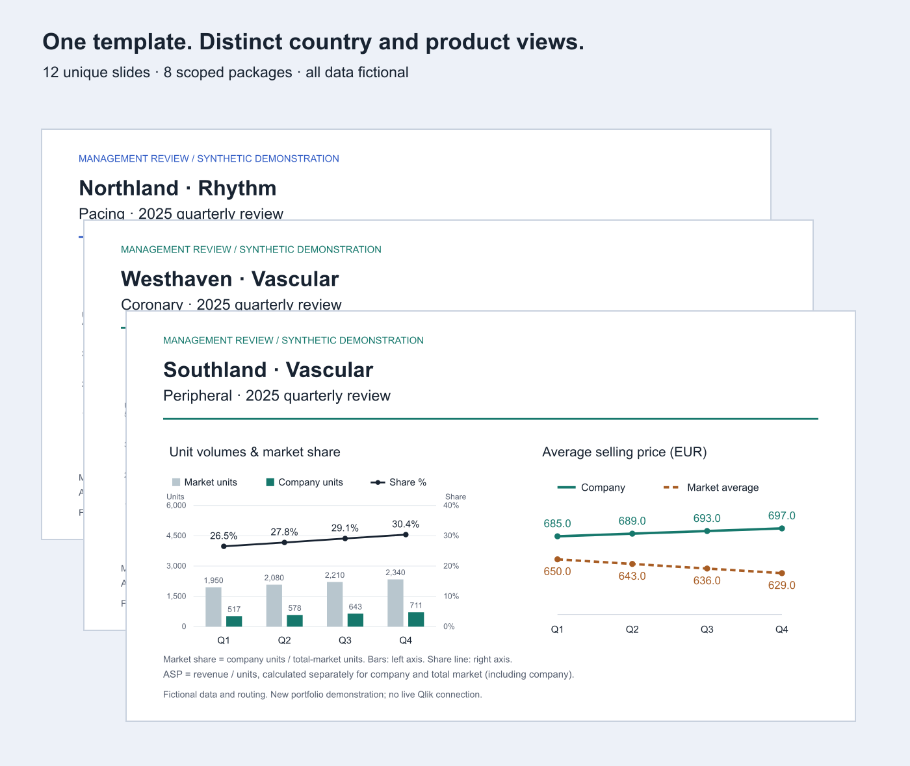

# Qlik Reporting Investigation

### A self-initiated investigation into scalable management reporting

**Matthew Bangle · Business analysis, reporting automation and process improvement · BIOTRONIK, 2024**

I initiated this investigation, taught myself the available Qlik reporting tools, built working examples and presented a recommendation for automating recurring management reports. I wanted to reuse the data and visualisations already maintained across Qlik applications, rather than make every region reconstruct the same management package manually.

The work progressed from a first Tabular report to country- and division-specific output, a comparison of reporting approaches, consultation with Qlik technical specialists, and a close recreation of the existing presentation style. It established a practical route toward reusable reporting templates. Wider adoption needed central ownership and coordinated access across applications.



**The visual above is a new synthetic demonstration:** 12 unique country/product slides assembled into 8 scoped packages, with 24 slide placements. It illustrates the reporting pattern; these are not historical production-volume figures.

**The volume chart pairs total-market and company unit bars with an overlaid market-share line.** This lets a reader distinguish market growth from company growth and see whether share is increasing. Both bars use the same zero-based unit axis; the percentage line uses a separate, labelled axis.

The pricing chart compares **company average selling price with the total-market average for the same country, product group and quarter**. Comparing these trends was a management priority: is our pricing moving with the market, or diverging from it? The fictional example deliberately shows company pricing increasing while the market average falls. It illustrates the question, without implying this was a historical BIOTRONIK result.

Both averages use revenue divided by units within the matching scope. The total market includes the company; it is not a competitor-only average. Market share remains company units divided by total-market units. When combining scopes, the demo calculates ratios from summed revenue and units, rather than averaging the displayed averages.

## Explore the work

- [Investigation and decisions](docs/case-study.md): what I initiated, learned, built and recommended.
- [Tabular versus Application Automation](docs/approach-comparison.md): the trade-offs I documented in 2024, with Subscriptions as a third option.
- [Presentation-layout study](docs/layout-study.md): cropped comparisons from three retained iterations, with the remaining alignment limitations explained.
- [Country and division reporting](reports/index.html): generated report packages; download the repository and open this file locally. GitHub does not run HTML files directly.
- [Editable sample slides](reports/Country-Product-Report.pptx): fictional market share and company-versus-market average selling price trends.
- [Evidence and scope](docs/evidence.md): what the contemporary records establish and what remains my retrospective account.

## My ownership

This was self-driven. I identified the opportunity, sought access, learned the tools, built prototypes, investigated limitations, organised discussions with Qlik specialists, and brought findings and proposals to regional management and the central Qlik team.

I also did the detailed implementation work that makes an idea testable: report filters and recipient lists, reusable presentation sheets, font and grid comparisons, export experiments, and requests to resolve the remaining permissions and mail-connector issues. Consultants helped clarify feasibility; they did not build the prototype work presented here.

## What I built and learned

| Work | Contribution |
| --- | --- |
| Tabular reporting | Built and shared a report template and initial outputs. Investigated country/product filter behaviour, levels, page generation and recipient-specific distribution. |
| Reporting-tool evaluation | Compared the benefits and constraints of Tabular Reporting, Application Automation and PowerPoint Subscriptions against a management-report requirement. |
| Presentation recreation | Recreated cover, agenda, chapter and content layouts inside Qlik. Compared typography, title placement, margins and other alignment details with the existing PowerPoint format. |
| Multi-app reporting prototype | Developed an example approach using sheets from multiple applications, with reusable presentation layouts. |
| Feasibility investigation | Consulted Qlik technical specialists and shared the findings, constraints and next steps with stakeholders. |
| Adoption proposal | Proposed a centrally reusable reporting-template approach that could reduce repeated preparation work and make regional reports more consistent. |

## Why it did not become a global reporting process

The limiting factor was organisational readiness as well as technology. In my experience, there was no designated central owner with the mandate and coordinated access needed to assemble and maintain reporting across the relevant applications. Regional needs also competed with centrally maintained dashboard priorities.

Related work, including a senior-management cockpit, provided some of the groundwork. Turning that into a shared regional reporting service would still have required an agreed owner, a supported access model and a commitment to maintain the output for regional users. Those conditions were not in place for the wider approach I proposed.

**My assessment:** the idea was ahead of the organisation’s readiness to operate it. I see the investigation and prototypes as valuable completed work; global harmonisation and the replacement of regional report preparation remained potential benefits, not achieved rollout outcomes.

## Run the synthetic demonstration

Python 3.9 or later; no third-party dependencies are required for the HTML/SVG report generator.

```sh
python3 demo/build.py
python3 -m unittest discover -s tests -v
```

Open `reports/index.html`. The generator creates twelve country/product-group slides, six country/division packages and two regional/division packages. All addresses use the reserved `example.invalid` domain. It writes files only and sends no email.

This is a current, transparent illustration of scope selection and report generation. It does not run Qlik, implement Qlik section access or reproduce the original automation. The downloadable PowerPoint is a separate presentation of the same fictional data; the Python command rebuilds HTML, SVG, CSV and JSON outputs.

## What stays private

Original employer figures, full presentations, email threads, recipient lists, app exports, tenant links and access configuration are excluded. The public evidence consists of a written account, limited non-financial layout excerpts and a fully fictional demonstration. See [evidence and scope](docs/evidence.md) for the distinction between contemporary records, my account and new demonstration material.

[Portfolio](https://matthew-bangle-data-portfolio.mattbangle.chatgpt.site) · [LinkedIn](https://www.linkedin.com/in/matthew-bangle/)
