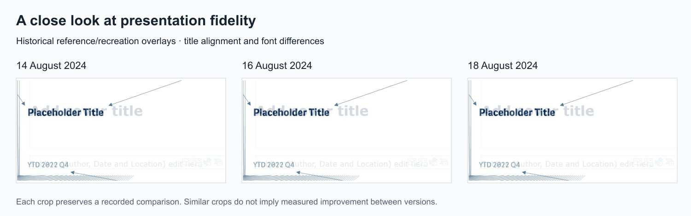

# Recreating the presentation layout

I aimed for near-pixel-perfect reproduction of the presentation language inside Qlik. That meant treating title placement, baseline, margins, type size and background alignment as implementation requirements, rather than accepting a default dashboard export.

These are narrow crops from my original comparison slides dated 14, 16 and 18 August 2024. Each source slide superimposed the reference PowerPoint layout and the Qlik recreation. The darker and lighter title text expose differences in size and alignment. The crops preserve the original comparison; they are not newly generated evidence of historical accuracy.

| Iteration | What it records |
| --- | --- |
| 14 August | Presentation-sheet recreation, a reference/recreation overlay and explicit notes on alignment and fonts. |
| 16 August | A more developed comparison package and the investigation of finer grid control. |
| 18 August | The latest retained comparison, including multi-app context and reusable presentation-sheet examples. |

Similar crops across iterations are retained honestly. They do not demonstrate a measured reduction in pixel error between dates. The full comparison packages contained additional context and examples, but remain private.

## What was close and what remained

My contemporaneous annotations describe very close vertical alignment and matching background placement. They also identify a remaining font-size mismatch, incomplete font harmonisation and grid constraints on precise object placement. I subsequently requested assistance with finer grid settings.

The result demonstrates careful recreation and an explicit assessment of residual differences. “Near-pixel-perfect” describes my design ambition and the close alignment of selected elements. It is not a validated score for the whole template or a claim that every difference had been resolved.

## Public excerpt treatment

Only the title-area comparison is included. Company logos, figures, complete report pages, app links, footer details and internal configuration are outside the crop. The original files remain private. New fictional report slides in this repository use a separate neutral design and contain no employer presentation artwork.
